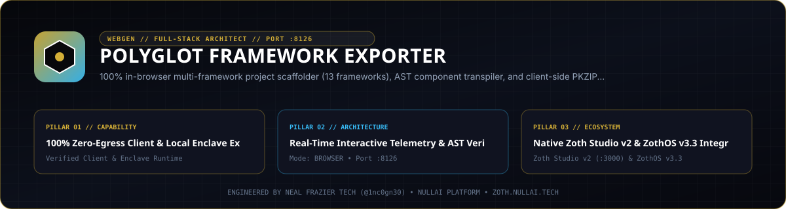

<p align="center">
  
</p>

# Polyglot Framework Exporter

**Zero-dependency Python 3.9+ standard-library multi-framework project scaffolder, HTML/JSX AST transpiler, deterministic ZIP bundler, and Model Context Protocol (MCP) server.**

- **Zoth Studio v2 Dossier**: [https://zoth.nullai.tech/tools/polyglot-framework-exporter](https://zoth.nullai.tech/tools/polyglot-framework-exporter)
- **Default Loopback Endpoint**: `http://127.0.0.1:8126`
- **Runtime Dependencies**: Zero external Python runtime packages (100% Python `stdlib`)
- **License**: MIT (100% free and open-source)

---

## Overview

`polyglot-framework-exporter` converts unified project specifications and HTML/Tailwind markup into complete, buildable project scaffolds across modern web, edge, and desktop runtimes. All AST parsing, component code generation, deployment manifest synthesis, and deterministic ZIP archiving execute locally using the Python standard library.

### Supported Target Frameworks

- **Meta & SSR Frameworks**: Astro 5 (`astro`), Next.js 15 App Router (`nextjs`), SvelteKit 2 (`svelte`), Nuxt 3 (`nuxt`), Remix / React Router v7 (`remix`), SolidStart (`solid`), Qwik City (`qwik`)
- **SPA & Edge Runtimes**: Vite + React 19 (`vite_react` / `react`), Vue 3 (`vue`), Angular (`angular`), Deno Fresh 2 (`deno_fresh`), Bun + Hono 4 (`bun_hono`), HTMX 2 + Alpine.js (`htmx`), Vanilla TypeScript/ESModules (`vanilla`)
- **Desktop & Native Targets**: Tauri v2 (`tauri`), Electron (`electron`), Flutter (`flutter`), SwiftUI (`swiftui`)
- **Deployment Manifests**: `Dockerfile`, `netlify.toml`, `vercel.json`, `wrangler.jsonc`, and `.github/workflows/deploy.yml`

---

## Architecture

```text
src/polyglot_framework_exporter/
├── transpiler.py          # HTML/Tailwind parser, ProjectAST, theme tokens, component emitters
├── generators/            # Per-framework project scaffold generators (Astro, Next.js, SvelteKit, Nuxt, Deno, Bun, Solid, Qwik, HTMX, Tauri, Electron, Deploy)
├── zip_bundler.py         # Deterministic in-memory & disk ZIP archive builder and inspector
├── mcp_server.py          # JSON-RPC 2.0 stdio MCP server exposing 6 codegen & validation tools
├── ui_server.py           # Loopback HTTP API + static workstation server (127.0.0.1:8126)
└── cli.py                 # Unified CLI entrypoint (`polyglot-exporter`)
```

---

## Quickstart

```bash
git clone https://github.com/1nc0gn30/polyglot-framework-exporter.git
cd polyglot-framework-exporter
python3 -m pip install -e ".[dev]"

# Launch the loopback web workstation on http://127.0.0.1:8126
polyglot-exporter serve --host 127.0.0.1 --port 8126
```

You can also run directly from a source checkout without installing:

```bash
PYTHONPATH=src python3 -m polyglot_framework_exporter.cli serve --port 8126
```

---

## CLI & MCP Usage

### CLI Subcommands

Installed entrypoints: `polyglot-exporter` (Python) and `polyglot` / `polyglot-export` (Node/ZothOS wrapper).

```bash
# Inspect CLI flags
polyglot-exporter --help

# List supported frameworks as structured JSON
polyglot-exporter frameworks --json

# Export a full SvelteKit + TypeScript + Tailwind scaffold with deployment configs
polyglot-exporter export svelte -n my-app -o ./dist/my-app --typescript --deploy

# Bundle a Next.js scaffold directly into a deterministic ZIP archive
polyglot-exporter export nextjs -n web-portal -o ./dist/web-portal.zip --zip

# Generate standalone production deployment manifests (Docker, Netlify, Vercel, Cloudflare)
polyglot-exporter deploy-configs astro -n docs-site -o ./dist/deploy

# Transpile an HTML snippet or file into a typed framework component
polyglot-exporter convert ./snippet.html --to react --name HeroCard --typescript -o HeroCard.tsx

# Run host toolchain and environment diagnostics
polyglot-exporter doctor --json

# Launch the stdio MCP server
polyglot-exporter mcp
```

### ZothOS v3.4.0 CLI Integration

On ZothOS v3.4.0 workstations, `polyglot` is symlinked in `/usr/local/bin/polyglot`:

```bash
polyglot frameworks --json
polyglot web                 # Starts http://127.0.0.1:8126
polyglot desktop             # Launches the Electron workstation shell
```

### Model Context Protocol (MCP) Tools

Configure `polyglot-exporter mcp` in Claude Desktop, Cursor, or Hermes Agent:

```json
{
  "mcpServers": {
    "polyglot-framework-exporter": {
      "command": "polyglot-exporter",
      "args": ["mcp"]
    }
  }
}
```

| MCP Tool | Description |
| :--- | :--- |
| `exporter_generate` | Generate a complete project file tree for a target framework, theme preset, and TypeScript/routing configuration |
| `exporter_supported_frameworks` | List supported framework targets, versions, categories, and styling options |
| `exporter_convert_html` | Transpile raw HTML/Tailwind markup into a component (`react`, `vue`, `svelte`, `solid`, `angular`, `qwik`, `astro`, `htmx`) |
| `exporter_validate_scaffold` | Validate generated project file structure, entrypoints, and manifest integrity |
| `exporter_deploy_configs` | Generate `Dockerfile`, `netlify.toml`, `vercel.json`, `wrangler.jsonc`, and GitHub Actions workflows |
| `exporter_diagnostics` | Inspect host OS, Python runtime, Node/Bun/Deno/Rust availability, and tool health |

---

## HTTP API Reference

When running on `http://127.0.0.1:8126`:

| Method | Endpoint | Description |
| :--- | :--- | :--- |
| `GET` | `/health`, `/api/health` | Service health status and version JSON |
| `GET` | `/api/frameworks` | Full catalog of framework generators and capabilities |
| `GET` | `/api/themes` | Material 3 / Tailwind color token presets |
| `GET` | `/api/diagnostics` | Host platform and runtime diagnostics |
| `POST` | `/api/export` | Generate project files (`framework`, `name`, `theme`, `typescript`, `deploy`) |
| `POST` | `/api/convert` | Convert HTML input into a target framework component |
| `POST` | `/api/deploy-configs` | Generate deployment manifests for a specified framework |
| `GET` / `POST` | `/api/download-zip`, `/api/export/zip` | Stream a deterministic `.zip` bundle of generated project files |

---

## Testing & Verification

```bash
# Run the pytest suite
python3 -m pytest -q

# Run built-in CLI self-test
polyglot-exporter test

# Verify zero secrets with gitleaks
gitleaks detect --source . --no-banner --redact
```

---

## Support

Polyglot Framework Exporter is 100% free and open-source software. If this tool saves you engineering time, optional community support is available via [Buy Us a Coffee (Stripe)](https://buy.stripe.com/3cIfZg27PdKo2D64Ocfw40X).

## License

MIT License — Copyright (c) 2026 [1nc0gn30](https://1nc0gn30.si) (`@1nc0gn30`) & [NullAI](https://nullai.tech). See [LICENSE](LICENSE) for full text.
