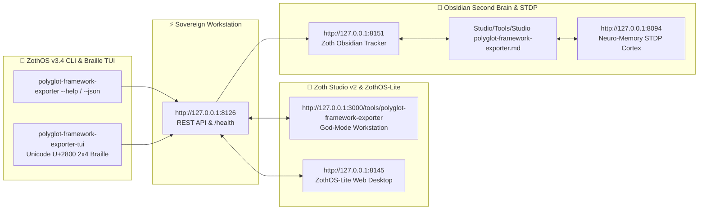

<div align="center">
  
</div>

<br />

# 🚀 Polyglot Framework Exporter

> ⚡ **Live Web Application**: [https://polyglot-framework-exporter.netlify.app](https://polyglot-framework-exporter.netlify.app)  
> 💻 **Zoth Studio Enclave**: [https://zoth.nullai.tech/tools/polyglot-framework-exporter](https://zoth.nullai.tech/tools/polyglot-framework-exporter)  
> ☕ **Buy Us a Coffee**: **[Support via Stripe](https://buy.stripe.com/3cIfZg27PdKo2D64Ocfw40X)**  
> ⚡ **Web3 Solana Tip**: Receiver `GG2eQbVh8ut1BK6j1A2tz7pSySdLpD38BgyEhGcxdXoK`  
> 🔓 **100% Free & Open Access**: Zero paywalls, zero license keys, zero feature gating.  
> ⚡ **Attribution**: Engineered by 1nc0gn30 • NullAI ([@1nc0gn30](https://github.com/1nc0gn30)) • NullAI Platform.

> **Universal Zero-Dependency Multi-Framework Scaffolder, AST Component Transpiler, Material 3 Web Studio & Model Context Protocol (MCP) Server for Modern Web & Desktop Frameworks.**

[](https://polyglot.nullai.tech)
[](https://buy.stripe.com/3cIfZg27PdKo2D64Ocfw40X)
[](https://solana.fm/address/GG2eQbVh8ut1BK6j1A2tz7pSySdLpD38BgyEhGcxdXoK)
[](https://polyglot.nullai.tech)
[](https://zoth.nullai.tech/tools/polyglot-framework-exporter)
[](https://github.com/polyglot-framework/polyglot-framework-exporter/actions)
[](https://python.org)
[-success.svg)](pyproject.toml)
[](public/index.html)
[](LICENSE)
[](#-supported-frameworks-matrix)
[](#-master-theme-system)

---

## 📖 Overview

**Polyglot Framework Exporter** is a pure Python standard-library engine designed to transform semantic HTML, component ASTs, and design specifications into production-ready web and desktop projects across **13 modern frameworks** in seconds.

Built with **zero third-party runtime dependencies**, it includes:
1. **Multi-Framework Generators**: Full project scaffolding for Astro 5, Next.js 15, Vite React 19, SvelteKit 2, Nuxt 3, Deno Fresh 2, Remix / React Router v7, Bun + Hono 4, SolidStart 1.0, Qwik City 1.x, HTMX 2.0 + Alpine.js, Tauri v2, and Electron 30+.
2. **Multi-Target Deployment Configs**: Automated synthesis of Dockerfile, `.dockerignore`, `netlify.toml`, `vercel.json`, `wrangler.jsonc`, and GitHub Actions CI/CD workflows for any target framework.
3. **Universal Component AST Transpiler**: Cross-framework component converter translating JSX/TSX, Svelte runes, Vue 3 Composition SFCs, and Astro templates.
4. **Polyglot Studio Web UI**: Material 3 styled dashboard (design influenced by Material 3) with interactive framework selector, theme picker, live file tree inspector, syntax preview, and 1-click in-memory ZIP downloader.
5. **Model Context Protocol (MCP) Server**: Native JSON-RPC 2.0 stdio server providing LLMs (Claude Desktop, Cursor, Cline) with direct scaffolding, transpilation, and deploy tools.
6. **Deterministic In-Memory ZIP Bundler**: `io.BytesIO` archive generator for reproducible, instant `.zip` downloads without disk pollution.

---

## 📊 Supported Frameworks Matrix

| Framework | Version | Paradigm | Reactivity / Model | Bundler | Default Port | Primary Target |
| :--- | :--- | :--- | :--- | :--- | :--- | :--- |
| 🚀 **Astro** | 5.1.0 | Island Architecture / SSG | Multi-Framework Hydration | Vite 6 | `4321` | Netlify, Vercel, Cloudflare |
| ▲ **Next.js** | 15.0.0 | App Router / Hybrid | React Server Components (RSC) | Turbopack | `3000` | Vercel, Node.js Server |
| ⚛️ **Vite React** | 19.0.0 | Single Page App (SPA) | Hooks + Actions | Vite 6 | `5173` | Static Hosting, GitHub Pages |
| ⚡ **SvelteKit** | 2.12.0 | Compiler-Driven SPA/SSR | Svelte 5 Runes (`$state`, `$derived`) | Vite 6 | `5173` | Edge Adapters, Node |
| 💚 **Nuxt** | 3.14.0 | Universal Fullstack SSR | Vue 3 Composition API (`<script setup>`) | Nitro / Vite | `3000` | Universal Deployments |
| 🍋 **Deno Fresh** | 2.0.0 | Islands Architecture | Preact + JIT Zero-Build | Deno Native | `8000` | Deno Deploy, Edge |
| 💿 **Remix / RRv7** | 2.12.0 | Web Standards Fullstack | Nested Loaders & Actions | Vite 6 | `3000` | Netlify, Fly.io, Cloudflare |
| 🍞 **Bun + Hono** | 4.6.14 | Edge API & Fullstack | TypeScript Server Actions + Zod | Bun Native | `3000` | Cloudflare, Fly.io, Edge |
| 💙 **SolidStart** | 1.0.10 | Fine-Grained Fullstack | Signals / No Virtual DOM | Vinxi / Vite | `3000` | Netlify, Vercel, Node |
| ⚡ **Qwik City** | 1.12.0 | Resumable SSR / SPA | Signals + Lazy Closures (`$`) | Vite 6 | `5173` | Cloudflare Pages, Edge |
| ⚡ **HTMX + Alpine** | 2.0.4 | Hypermedia Single-Page | Alpine Client State + Python Server | Zero-Build | `8000` | Python Hosting, Docker, VPS |
| 🦀 **Tauri** | 2.0.0 | Lightweight Native Desktop | Rust Backend + Webview Frontend | Cargo / Vite | Desktop | macOS, Windows, Linux (.app/.exe/.deb) |
| ⚡ **Electron** | 33.0.0 | Cross-Platform Desktop | Chromium + Node.js IPC Bridge | Vite / Node | Desktop | Windows, macOS, Linux (.exe/.dmg) |

---

## 🎨 Master Theme System

Every generated project includes a complete design token mapping supporting 6 Master Themes:

- **Material 3 Light (`light_material`)**: Clean design influenced by Google Material Design 3 tokens, elevation shadows, and rounded container cards.
- **Material 3 Dark (`material_dark`)**: High-contrast dark mode with tonal surface elevation (`#121212` / `#1e1e1e`) and blue accents (`#8ab4f8`).
- **Obsidian Gold (`obsidian_gold`)**: Deep obsidian dark surfaces (`#0a0a0a`) paired with gold metallic accents (`#ffd700`).
- **Midnight Neon (`midnight_neon`)**: Cyberpunk aesthetic featuring deep space navy (`#070913`) and electric cyan/magenta (`#00f0ff` / `#ff007f`).
- **Acid Grid (`acid_grid`)**: High-energy hacker aesthetic with radioactive lime green (`#76ff03`) and terminal dark panels.
- **Ultraviolet Glass (`ultraviolet_glass`)**: Modern frosted-glass dark UI with neon violet (`#a855f7`) and indigo accents.

---

## 🏛️ System Architecture

```
                                  ┌─────────────────────────────┐
                                  │   User / AI Agent / LLM    │
                                  └──────────────┬──────────────┘
                                                 │
                   ┌─────────────────────────────┼─────────────────────────────┐
                   │                             │                             │
                   ▼                             ▼                             ▼
        ┌─────────────────────┐       ┌─────────────────────┐       ┌─────────────────────┐
        │  CLI Interface      │       │ Polyglot Studio     │       │  Model Context      │
        │  (polyglot-exporter)│       │ (Web UI/API)        │       │  Protocol (MCP)     │
        └──────────┬──────────┘       └──────────┬──────────┘       └──────────┬──────────┘
                   │                             │                             │
                   └─────────────────────────────┼─────────────────────────────┘
                                                 │
                                                 ▼
                             ┌───────────────────────────────────────┐
                             │    Universal AST & Transpiler Core   │
                             │  (HTML / Markdown / JSON -> AST)      │
                             └───────────────────┬───────────────────┘
                                                 │
                                                 ▼
                             ┌───────────────────────────────────────┐
                             │       Framework Generator Hub         │
                             │  (Astro, Next.js, Vite, Svelte, etc.) │
                             └───────────────────┬───────────────────┘
                                                 │
                                                 ▼
                             ┌───────────────────────────────────────┐
                             │  In-Memory ZIP Bundler & File Writer  │
                             │  (Deterministic BytesIO / Disk Export)│
                             └───────────────────────────────────────┘
```

---

## ⚡ Quick Start

### 1. Installation

Polyglot Framework Exporter requires **Python 3.9+** and has **zero external runtime dependencies**.

```bash
# Clone the repository
git clone https://github.com/polyglot-framework/polyglot-framework-exporter.git
cd polyglot-framework-exporter

# Install in development mode
pip install -e .
```

### 2. Launch Polyglot Studio (Web UI)

Start the interactive Material 3 Web Studio on `http://127.0.0.1:8080`:

```bash
polyglot-exporter serve --open
# or directly with python:
python -m polyglot_framework_exporter.ui_server --port 8080 --open
```

### 3. CLI Project Generation

Export a complete project directly to disk or as an in-memory `.zip` bundle:

```bash
# Scaffold an Astro 5 project with Obsidian Gold theme
polyglot-exporter export --framework astro --name my-astro-site --theme obsidian_gold --output ./dist/my-astro-site

# Scaffold a Next.js 15 App Router project directly into a ZIP archive
polyglot-exporter export --framework nextjs --name next-saas --zip ./next-saas.zip

# List all supported frameworks and metadata
polyglot-exporter list
```

### 4. Cross-Framework Component Transpilation

Convert component code across frameworks instantly:

```bash
# Convert a React JSX component to Svelte 5 runes
polyglot-exporter transpile --source react --target svelte --input ./Hero.tsx --output ./Hero.svelte

# Convert an HTML snippet to an Astro component
polyglot-exporter transpile --source html --target astro --code "<button class='btn-primary'>Click me</button>"
```

---

## 🛠️ Command-Line Interface (CLI) Guide

```
usage: polyglot-exporter [-h] [--version] {export,list,transpile,serve,mcp,diagnostics} ...

Commands:
  export       Scaffold a complete framework project to disk or .zip
  list         List all supported target frameworks and metadata
  transpile    Transpile a component or HTML snippet across frameworks
  serve        Launch Polyglot Studio Web UI & REST API server
  mcp          Start Model Context Protocol (MCP) server over stdio
  diagnostics  Display system environment, path, and runtime diagnostics

Options:
  -h, --help   show this help message and exit
  --version    show program's version number and exit
```

---

## 🤖 Model Context Protocol (MCP) Configuration

Polyglot Framework Exporter includes a native, full-featured **Model Context Protocol (MCP)** server for AI coding assistants such as Claude Desktop, Cursor, Cline, and OpenCode.

### 1. Claude Desktop Setup

Add to your `claude_desktop_config.json` (`~/Library/Application Support/Claude/claude_desktop_config.json` on macOS or `%APPDATA%\Claude\claude_desktop_config.json` on Windows):

```json
{
  "mcpServers": {
    "polyglot-framework-exporter": {
      "command": "python3",
      "args": [
        "-m",
        "polyglot_framework_exporter.mcp_server"
      ]
    }
  }
}
```

### 2. Cursor Setup

Add to `.cursor/mcp.json` in your workspace:

```json
{
  "mcpServers": {
    "polyglot-framework-exporter": {
      "command": "python",
      "args": ["-m", "polyglot_framework_exporter.mcp_server"]
    }
  }
}
```

### 3. Exposed MCP Tools

- **`exporter_generate`**: Scaffold and generate a complete application for any framework with themes and Tailwind.
- **`exporter_supported_frameworks`**: Query all supported frameworks, versions, templates, and styling options.
- **`exporter_convert_html`**: Transpile raw HTML, JSX, or component trees to idiomatic target framework code.
- **`exporter_validate_scaffold`**: Validate project structure, dependencies, and configuration sanity.
- **`exporter_diagnostics`**: Inspect system environment and framework readiness.
- **`exporter_deploy_configs`**: Generate production deployment configurations (Dockerfile, .dockerignore, netlify.toml, vercel.json, wrangler.jsonc, deploy.yml).

---

## 🌐 REST API Reference

When the UI Server is running (`polyglot-exporter serve`), the following REST endpoints are available:

| Method | Endpoint | Description |
| :--- | :--- | :--- |
| `GET` | `/` | Serves Polyglot Studio UI (`public/index.html`) |
| `GET` | `/api/health` | Server uptime, version, and health status |
| `GET` | `/api/frameworks` | List all 13 supported frameworks with metadata |
| `POST` | `/api/export` | Generate project file tree JSON for a framework |
| `POST` | `/api/convert` | Transpile component code across frameworks |
| `GET/POST`| `/api/download-zip` | Stream an in-memory binary `.zip` file download |
| `GET/POST`| `/api/deploy-configs` | Synthesize Dockerfile, Netlify, Vercel, Cloudflare, and CI configs |
| `GET` | `/api/diagnostics` | System diagnostics, CPU, memory, and runtime environment |

---

## 🧪 Running Tests

The test suite provides comprehensive coverage across all modules:

```bash
# Run all tests with pytest
pytest

# Run tests with coverage report
pytest --cov=polyglot_framework_exporter --cov-report=term-missing -v
```

---

## ☕ 100% Free & Open-Access (Buy Us a Coffee Support Architecture)

Polyglot Framework Exporter and Polyglot Studio are **100% free, open, and unlocked by default**. Zero paywalls, zero license keys, and zero locked features.

If this project powers your workflows or saves you engineering hours, consider supporting its independent research:

- **Stripe "Buy Us a Coffee"**: [Support via Stripe](https://buy.stripe.com/3cIfZg27PdKo2D64Ocfw40X) (Cards, Apple Pay, Google Pay)
- **Solana Tip Address**: `GG2eQbVh8ut1BK6j1A2tz7pSySdLpD38BgyEhGcxdXoK`
- **Sovereign Invariants**: 13-framework scaffolding, in-memory zero-dependency PKZIP bundling, cross-framework AST transpilation, and 100% client-side zero-egress execution.

---

## 💻 ZothOS CLI & MCP Integration

```bash
# Verify installation & deterministic JSON telemetry
polyglot-framework-exporter --json
polyglot-framework-exporter --version

# Scaffold a project for any of the 13 frameworks
polyglot-framework-exporter export --framework astro --name my-app --out ./my-app

# Generate production deployment configurations
polyglot-framework-exporter deploy-configs --framework nextjs

# Transpile component code across frameworks
polyglot-framework-exporter convert --source react --target svelte --input ./Component.jsx

# Launch MCP Server for Claude Desktop & Cursor
polyglot-framework-exporter mcp
```

---

## 📄 License & Attribution

This project is open source and available under the [MIT License](LICENSE).

**Engineered by [1nc0gn30 • NullAI](https://nullai.tech) ([@1nc0gn30](https://github.com/1nc0gn30)) • [NullAI Platform](https://nullai.tech)**

---

## 🏛️ ZothOS v3.4, Zoth Studio v2 & Obsidian Second Brain Ecosystem



### Cross-Surface Integration Matrix

| Surface | Endpoint / Binary | Capabilities |
| :--- | :--- | :--- |
| **Standalone Workstation** | `http://127.0.0.1:8126` | 100% Free & Open-Access Web Deck, live `/health` & REST telemetry |
| **Zoth Studio v2 Route** | `http://127.0.0.1:3000/tools/polyglot-framework-exporter` | Interactive God-Mode component inside Zoth Studio (`https://zoth.nullai.tech`) |
| **ZothOS v3.4 CLI & TUI** | `polyglot-framework-exporter` / `polyglot-framework-exporter-tui` | Global binary in `/usr/local/bin/` with Unicode `U+2800` Braille TUI & `--json` output |
| **ZothOS-Lite Web Desktop** | `http://127.0.0.1:8145` | Browser-native KDE-style window manager & terminal launcher |
| **Zoth Obsidian Tracker** | `http://127.0.0.1:8151` | Interactive Obsidian Second Brain vault explorer (`~/Documents/Obsidian Vault/Studio/Tools/Studio polyglot-framework-exporter.md`) |
| **Neuro-Memory STDP Cortex** | `http://127.0.0.1:8094` | 3-Factor STDP synaptic memory daemon & 21-tool MCP server |

```bash
# Inspect CLI & Unicode U+2800 Braille TUI on ZothOS v3.4
polyglot-framework-exporter --help
polyglot-framework-exporter-tui --status
polyglot-framework-exporter-tui --json

# Verify Second Brain Vault & 12-Step Verification Gallery on :8151
zoth-obsidian-tracker --verify
```

